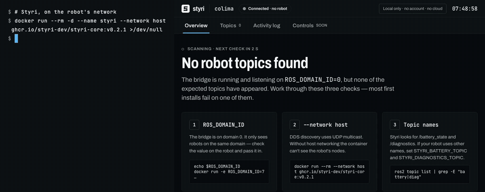

<!-- Storefront README for the PUBLIC styri repo. Replace the hero GIF path once recorded. -->

<p align="center">
  
</p>

# Styri

**The ROS 2 web dashboard and operator panel that never leaves your network.**

Open-source, offline-first operator panel for ROS 2 robots. Runs on the robot or a local box, works in any browser on the LAN. No cloud, no account, no outbound calls. One command to start.

[Website](https://styri.dev) · [Quickstart](#quickstart) · [How it compares](#how-styri-compares) · [Pricing](#editions)

---

## Quickstart

Run it on any ROS 2 machine (Humble or Jazzy, amd64 or arm64):

```bash
docker run --rm --network host ghcr.io/styri-dev/styri-core:v0.2.0
```

Open **http://localhost:8080**. Styri finds your robot's topics over DDS and shows them live.

Host networking lets Styri see DDS discovery on your LAN. Open source: [read the code](.) before you run it.

**No robot handy?** Run the simulated robot and the panel together:

```bash
docker compose up
```

## What you get

- **Overview** — robot status, battery, voltage, CPU temperature and link health, readable at a glance on a touchscreen
- **Topics** — every discovered topic with its rate and last-message age
- **Activity log** — a local log of connections, warnings and state changes, exportable to CSV
- **Honest data** — every value shows when it goes stale; disconnects are obvious

Styri Core is **read-only**: it never publishes to your robot. Controls are on the [roadmap](#roadmap).

## Nothing phones home

- Every asset is served locally: fonts, icons, scripts. No CDN.
- No telemetry, no license server, no account.
- Unplug the internet and it still works.

Verify it yourself:

```bash
sudo tcpdump -i any 'not net 10.0.0.0/8 and not net 172.16.0.0/12 and not net 192.168.0.0/16 and not host 127.0.0.1 and not net 224.0.0.0/4'
```

Nothing should appear while Styri runs. (DDS discovery uses LAN multicast, 224.0.0.0/4, which never leaves your network.)

## How Styri compares

| | RViz2 | Foxglove | Styri |
|---|---|---|---|
| Built for | Engineers | Engineers: data visualization and log analysis | Operators running robots on site |
| Offline use | Fully local | Free and Pro: desktop app streams live local data, but account sign-in needs internet. Fully offline via standalone license or on-prem deployment on Enterprise | Fully offline on every tier, including free |
| Runs in | Desktop / X11 on the robot or forwarded | Desktop app on each machine | Any browser on the LAN |
| Offline install | apt or source build | Desktop install + offline license activation | One `docker run` command |
| Source | Open source | Proprietary | Open-source core |

Foxglove helps engineers analyze robot data. Styri helps operators run robots — fully offline, from the free tier up.

## How it works

```
ROS 2 nodes ──DDS──▶ Styri bridge ──local WebSocket──▶ Styri panel ──LAN──▶ any browser
                         │
                         └──▶ local activity log (SQLite)
```

One container: a small bridge subscribes to your ROS 2 topics and serves a static web panel. Nothing leaves the machine except to browsers on your LAN.

## Configuration

Pass settings as environment variables, for example
`docker run -e ROS_DOMAIN_ID=7 -e STYRI_MIN_VOLTAGE=23.0 --rm --network host ghcr.io/styri-dev/styri-core:v0.2.0`.

| Variable | Default | |
|---|---|---|
| `ROS_DOMAIN_ID` | `0` | Must match the robot |
| `STYRI_ROBOT_NAME` | the host name | Shown in the header |
| `STYRI_BATTERY_TOPIC` | `/battery_state` | A `sensor_msgs/BatteryState` topic |
| `STYRI_DIAGNOSTICS_TOPIC` | `/diagnostics` | A `diagnostic_msgs/DiagnosticArray` topic |
| `STYRI_MIN_VOLTAGE` | unset | Volts. Below this the Voltage tile turns amber and the status shows a low-voltage warning, whatever the charge reads. Unset, voltage is shown but never judged. |

All settings: [docs/DEVELOPMENT.md](docs/DEVELOPMENT.md#configuration). Something not showing up? See [docs/TROUBLESHOOTING.md](docs/TROUBLESHOOTING.md).

## Roadmap

- **Controls** — software stop, hold-to-drive teleop and waypoint dispatch, with sign-in and roles. A software stop never replaces the robot's hardware E-stop.
- **Fleet view** — many robots, one screen.
- **Air-gapped delivery** — signed offline install package, SBOM and compliance audit exports.

## Editions

| | Core | Commercial Pilot | Air-Gapped Enterprise |
|---|---|---|---|
| Price | Free (open source) | $3,600/yr | Contact us |
| Status | Available now | Coming soon | Coming soon |
| Robots | 1 | Up to 5 | Unlimited |
| Network | Local LAN | Local LAN | Air-gapped site, site-wide |
| Includes | Read-only operator panel, live telemetry, local activity log | Everything in Core, plus fleet view across robots and direct support | Everything in Pilot, plus offline Zarf package, compliance audit log exports, offline hardware-locked license |
| | You're here | [Talk to us](https://styri.dev/#talk) | [Contact us](https://styri.dev/#talk) |

Running more than one robot, or deploying to a site without internet? [Talk to us](https://styri.dev/#talk).

## Contributing

Issues and pull requests are welcome. See [docs/DEVELOPMENT.md](docs/DEVELOPMENT.md) to build and test locally.

## License

Apache-2.0. See [LICENSE](LICENSE).
