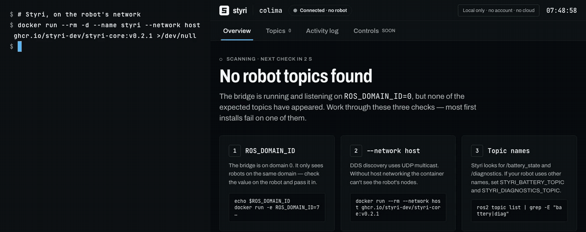

<!-- Storefront README for the PUBLIC styri repo. -->

# Styri

Styri — one offline operator panel for ROS 2 and VDA 5050 robots. See, send and stop a mixed fleet from any browser on site. No cloud, no account. Free for up to 3 robots.

<!-- VIDEO PLACEHOLDER: swap the hero below for a GIF made from the 90-second video, linking to the MP4, when the owner sends it. The hero was recorded with v0.3.1 and shows the old panel. -->
<p align="center">
  
</p>
<p align="center"><sub>[VIDEO] Placeholder: the 90-second demo goes here.</sub></p>

## Quickstart

Run it on any Linux box on the robots' network (amd64 or arm64):

```bash
docker run --rm --network host ghcr.io/styri-dev/styri-core:v2.0.0
```

Open **http://&lt;this machine's IP&gt;:8080**. Host networking lets Styri see DDS discovery on your LAN. Open source: [read the code](.) before you run it.

**A mixed fleet, no hardware?** One ROS 2 robot and two VDA 5050 vehicles on one map, all simulated:

```bash
cd examples/mixed-fleet && docker compose up
```

The first run builds the simulated robots, which takes a few minutes. Open **http://localhost:8080** and log in with `styri-demo`. `docker compose down -v` resets the demo, map edits included.

**On a Mac?** Run Styri on the robot or any Linux machine on its network, and open the panel from any browser, Mac included. Docker on macOS can't see a robot on another machine, but the mixed-fleet demo runs there too.

## What you get

- **Mixed-fleet map** — ROS 2 and VDA 5050 robots on one site map, each with its verdict and battery
- **Command status** — a goal shows Sent, Accepted, Running, Done, or why it failed, from what the robot reports
- **Operator stop with confirmation** — per robot or Stop all, then "Stopped", "No reply from robot" or "Stop NOT confirmed"
- **Roles** — viewer, operator and admin accounts, on the Users screen or with `styri users`
- **Audit log** — every command and refusal in a local append-only log
- **`styri check`** — tests your config against the live robots and broker, PASS or FAIL per line

## Control and safety

Control is off until an admin turns it on. Operator stop is a software stop, not a safety function. Read [SAFETY.md](SAFETY.md) before you turn control on.

## Compatibility

[docs/COMPATIBILITY.md](docs/COMPATIBILITY.md) lists what Styri supports. So far it has been tested against simulators only: Nav2's loopback simulator, Styri's own ROS 2 sim and vda-5050-lib's virtual AGV, not a real vendor robot.

## Editions

| | Robots | Price | |
|---|---|---|---|
| Core | Up to 3, one site | Free, open source (Apache-2.0) | You're here |
| Pilot | Up to 20, one site | $360/month or $3,600/year | [Buy or talk to us](https://styri.dev/#pricing) |
| Enterprise | More robots, multiple sites | Talk to us | [Talk to us](https://styri.dev/#talk) |

More than three robots? Styri Pilot is the public `ghcr.io/styri-dev/styri-pro` image plus a license file: [docs/PILOT.md](docs/PILOT.md).

## VDA 5050 bench

Free VDA 5050 bench: [styri-vda-bench](https://github.com/styri-dev/styri-vda-bench), an unofficial self-check.

## Help

Guides: [styri.dev/help](https://styri.dev/help). Something not showing up? See [docs/TROUBLESHOOTING.md](docs/TROUBLESHOOTING.md).

## Setup

Deploying to a client fleet? We can set it up for you. [Styri Setup](https://styri.dev/setup) or [talk to us](https://styri.dev/#talk).

## License

Apache-2.0. See [LICENSE](LICENSE). Bundled third-party software is listed in [NOTICE](NOTICE). Styri comes with no warranty and no safety certification: see [SAFETY.md](SAFETY.md).

## Nothing phones home

- Every asset is served locally: fonts, icons, scripts. No CDN.
- No telemetry, no license server, no account.
- Unplug the internet and it still works.

Verify it yourself:

```bash
sudo tcpdump -i any 'not net 10.0.0.0/8 and not net 172.16.0.0/12 and not net 192.168.0.0/16 and not host 127.0.0.1 and not net 224.0.0.0/4'
```

Nothing should appear while Styri runs. (DDS discovery uses LAN multicast, 224.0.0.0/4, which never leaves your network.)

## How it works

```
ROS 2 nodes ──DDS──▶ Styri bridge ──local WebSocket──▶ Styri panel ──LAN──▶ any browser
                         │
                         └──▶ local activity log (SQLite)
```

One container: a small bridge subscribes to your ROS 2 topics and serves a static web panel. Nothing leaves the machine except to browsers on your LAN.

## Configuration

Pass settings as environment variables, for example
`docker run -e ROS_DOMAIN_ID=7 -e STYRI_MIN_VOLTAGE=23.0 --rm --network host ghcr.io/styri-dev/styri-core:v2.0.0`.

| Variable | Default | |
|---|---|---|
| `ROS_DOMAIN_ID` | `0` | Must match the robot |
| `STYRI_ROBOT_NAME` | the host name | Shown in the header |
| `STYRI_BATTERY_TOPIC` | `/battery_state` | A `sensor_msgs/BatteryState` topic |
| `STYRI_DIAGNOSTICS_TOPIC` | `/diagnostics` | A `diagnostic_msgs/DiagnosticArray` topic |
| `STYRI_MIN_VOLTAGE` | unset | Volts. Below this the Voltage tile turns amber and the status shows a low-voltage warning, whatever the charge reads. Unset, voltage is shown but never judged. |

### Map your robot's topics

Different topic names, another message type, the robot's own status, or a few
values of your own? Describe them in one `styri.yaml` and mount it:

```yaml
robot: {name: amr-01, namespace: /robot1}
battery: {topic: battery, percentage: charge, percentage_scale: 1, warn_below: 30}
status: {topic: mode, field: data, fault: [ERROR, STOPPED]}
fields:
  - {label: Motor current, topic: motor/current, field: data, unit: A, warn_above: 12}
```

```bash
docker run --rm --network host -v "$PWD/styri.yaml:/etc/styri/styri.yaml:ro" ghcr.io/styri-dev/styri-core:v2.0.0 styri check
```

`styri check` tests the file against the live robot and names anything it can't
find, with close matches. Presets for Nav2 (navigation status), TurtleBot 4
and generic `BatteryState` robots ship in the image, along with Nav2's and
other common message types. Your robot's own message types load as an
[overlay](docs/MAPPING.md#your-own-message-types). The full reference:
[docs/MAPPING.md](docs/MAPPING.md).

All settings: [docs/DEVELOPMENT.md](docs/DEVELOPMENT.md#configuration). What works with what: [docs/COMPATIBILITY.md](docs/COMPATIBILITY.md). Something not showing up? See [docs/TROUBLESHOOTING.md](docs/TROUBLESHOOTING.md).

## Contributing

Issues and pull requests are welcome. See [docs/DEVELOPMENT.md](docs/DEVELOPMENT.md) to build and test locally.
